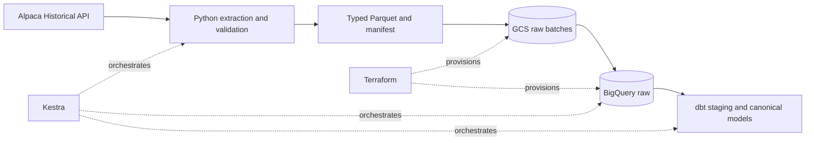
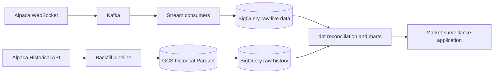

# Equity Data Platform

An end-to-end batch data pipeline for historical US equity market data, built as
the foundation for a future real-time market-surveillance platform.

The implemented pipeline extracts daily stock bars from Alpaca, validates and
publishes immutable Parquet batches to Google Cloud Storage, loads raw
observations into BigQuery, and builds a canonical table with dbt. Kestra
coordinates the workflow and Terraform provisions the cloud resources.

## Current implementation

The repository currently provides one complete vertical slice for historical
daily bars:

| Capability | Status |
| --- | --- |
| Configurable stock universe and inclusive backfill dates | Implemented |
| Source, schema, value, and market-session validation | Implemented |
| Typed Parquet output with checksums and a completion manifest | Implemented |
| Immutable raw batches in Google Cloud Storage | Implemented |
| Append-only raw loading into BigQuery | Implemented |
| dbt staging, canonical deduplication, and data tests | Implemented |
| Kestra extract, load, and transform child flows | Implemented |
| Terraform-managed GCS and BigQuery resources | Implemented |
| Kafka and Alpaca WebSocket ingestion | Planned |
| Liquidity marts, alerts, and analyst dashboard | Planned |

### Current architecture



The initial universe contains AAPL, MSFT, NVDA, AMZN, and META. Symbols are
configuration-driven and can be overridden for targeted backfills without
changing Python source code.

See [sample pipeline output](docs/examples/daily-bars-output.md) for a manifest
excerpt and Parquet record from a local run.

## Why this project exists

Analysts need a trustworthy historical baseline before they can decide whether
current price, volume, or liquidity behavior is unusual. A baseline assembled
from overlapping requests and provider updates can otherwise contain repeated
or inconsistent observations.

The pipeline preserves the source observations and exposes one deterministic
version of each daily bar for analysis. This historical layer will later provide
the comparison baseline for the planned live market-surveillance application.

## Data contract

Each bar contains the source OHLCV values, trade count, and VWAP together with:

- source, feed, timeframe, and adjustment
- run and deterministic batch identifiers
- a logical bar key and payload fingerprint
- ingestion timestamp and schema version

A batch is considered complete only after all Parquet parts pass validation and
its manifest has been published. Repeated and overlapping runs remain in the
raw layer. The canonical table selects the latest accepted observation for each
bar key.

## Planned product direction

The longer-term goal is real-time market surveillance and liquidity
intelligence. The planned streaming path is intentionally separate from the
implemented historical path:



This phase will add trades, quotes, updated bars, trading statuses, trade
corrections, and cancellations. Live observations will remain provisional until
they are reconciled against a later historical response.

## Technology stack

| Area | Current technology |
| --- | --- |
| Market data | Alpaca historical API and IEX feed |
| Extraction and validation | Python, alpaca-py, pandas, PyArrow |
| Raw data lake | Google Cloud Storage and Parquet |
| Data warehouse | BigQuery |
| Transformation and testing | dbt |
| Orchestration | Kestra |
| Infrastructure as code | Terraform |
| Containerization | Docker |

Apache Kafka and an analyst-facing application belong to the planned streaming
phase and are not part of the current implementation.

## Run the project

See the [development runbook](DEVELOPMENT.md) for prerequisites, cloud
provisioning, local startup, automated checks, Kestra execution, verification,
and recovery instructions.

The local automated checks are:

```bash
uv sync --frozen
uv run ruff check src tests scripts
uv run pytest -q
terraform -chdir=terraform fmt -check
terraform -chdir=terraform validate
```

## Documentation

- [Development runbook](DEVELOPMENT.md) explains how to reproduce and operate
  the development environment.
- [Reliability and recovery](PIPELINE_RELIABILITY.md) documents validation,
  retry boundaries, failure behavior, and remaining production controls.
- [Streaming ingestion design](STREAMING_INGESTION.md) is the accepted proposal
  for the future live-data path.
- [Alpaca stock-data inventory](docs/reference/alpaca-data-inventory.md) records
  the stock-related SDK interfaces evaluated for later datasets.

## Roadmap

1. Historical daily-bars producer and Docker image. Complete.
2. GCS and BigQuery infrastructure managed by Terraform. Complete.
3. Kestra backfills and dbt canonicalization. Complete.
4. Continuous integration checks for Python, Terraform, and dbt. Configured.
5. Real-time Alpaca ingestion through Kafka.
6. Streaming and historical reconciliation in BigQuery and dbt.
7. Market-surveillance and liquidity marts.
8. Analyst-facing monitoring application.

## Current limitations

- The implemented dataset contains historical daily bars only.
- Large requests are not yet chunked and should remain bounded.
- The development environment uses local Kestra, local Terraform state, and
  developer Application Default Credentials.
- Alpaca's free IEX feed represents only part of US market activity. Results
  describe IEX-observed conditions rather than the complete consolidated market.
