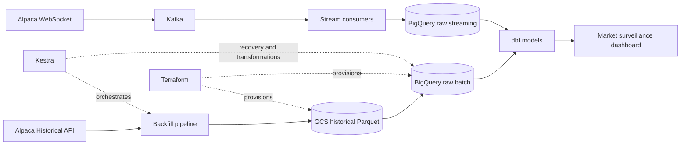

# Equity Data Platform

> Real-time market surveillance and liquidity intelligence for US equities.

Equity Data Platform monitors a configurable universe of stocks using Alpaca
market data. It combines real-time trades, quotes, bars, trading statuses, and
trade corrections with historical backfills to surface changing market
conditions through an analytical application.

## Why this project exists

Analysts monitoring many companies cannot manually follow every price move,
spread change, volume spike, trading halt, or corrected trade. Important
signals are distributed across several event streams and are difficult to
interpret without historical context.

This platform creates a unified view of live and historical activity so an
analyst can answer:

- Which symbols are experiencing unusual price or volume behavior?
- Where are bid/ask spreads widening and liquidity deteriorating?
- Which securities have been halted or resumed?
- Have corrections or cancellations changed the observed trade history?
- Is current activity abnormal compared with historical baselines?

The goal is market monitoring and research prioritization—not automated trading
or investment advice.

## What it does

The platform is built in five layers:

| Layer | Responsibility |
| --- | --- |
| Ingestion | Alpaca WebSocket events are consumed continuously; historical APIs backfill gaps and bootstrap history |
| Streaming | Kafka buffers and distributes trades, quotes, bars, statuses, corrections, and cancellations |
| Storage | BigQuery retains live observations; Parquet in GCS preserves historical batches and backfills |
| Analytics | BigQuery and dbt build reconciled market history, baselines, and analytical marts |
| Serving | A dashboard presents live conditions, alerts, historical comparisons, and data coverage |

Kestra orchestrates deployments, historical backfills, recovery workflows, and
downstream transformations. Terraform provisions the cloud infrastructure.

## Architecture



## Market intelligence produced

The planned application combines live monitoring with historical context:

- Price and return movements across the configured watchlist
- Abnormal volume and trade activity
- Bid/ask spread and displayed-liquidity changes
- Intraday and rolling volatility
- Trading halts and resumptions
- Trade correction and cancellation activity
- Data freshness, coverage, and ingestion health
- Historical company comparison and drawdown analysis

## Data sources

### Primary: real-time streaming

- Trades
- Quotes
- Minute bars and updated bars
- Daily bars
- Trading-status events
- Trade corrections
- Trade cancellations/errors

### Recovery and history: batch APIs

- Historical bars
- Historical trades
- Historical quotes
- Corporate actions
- Asset metadata
- Market calendar

Historical jobs bootstrap analytical baselines, repair missing periods, and
perform controlled backfills. They are not the primary ingestion path once the
streaming pipeline is operational.

## Initial implementation

The first vertical slice uses historical daily bars to establish the shared
contracts for configuration, validation, typed Parquet batches, manifests,
testing, and containerized execution. Kestra now coordinates extraction, GCS
publication, append-only BigQuery loading, and dbt canonicalization as separate
retryable child flows.

The initial stock universe is:

```text
AAPL, MSFT, NVDA, AMZN, META
```

The universe is configuration-driven and can be expanded without changing
Python source code.

## Technology stack

| Area | Technology |
| --- | --- |
| Market data | Alpaca historical and WebSocket APIs |
| Extraction and consumers | Python, alpaca-py, PyArrow |
| Event streaming | Apache Kafka |
| Raw data lake | Google Cloud Storage and Parquet |
| Data warehouse | BigQuery |
| Transformation and testing | dbt |
| Orchestration | Kestra |
| Infrastructure as code | Terraform |
| Containerization | Docker |
| Application layer | To be selected after the analytical marts are stable |

## Development

See the [development environment runbook](DEVELOPMENT.md) for prerequisites,
cloud provisioning, local startup, tests, Kestra execution, GCS verification,
shutdown, and recovery instructions.

## Project documentation

- [Development runbook](DEVELOPMENT.md) — reproduce the development environment
  and run the batch pipeline end to end.
- [Reliability and recovery](PIPELINE_RELIABILITY.md) — data contracts, failure
  boundaries, retry behavior, and remaining production controls.
- [Streaming ingestion design](STREAMING_INGESTION.md) — planned relationship
  between live market events, historical backfills, and reconciliation.

## Project roadmap

1. Complete the local historical daily-bars producer and Docker image. ✅
2. Provision GCS and BigQuery with Terraform. ✅
3. Orchestrate backfills and daily-bar reconciliation with Kestra and dbt. ✅
4. Ingest real-time Alpaca events through Kafka.
5. Reconcile streaming and historical observations in BigQuery with dbt.
6. Build market-surveillance and liquidity marts.
7. Deliver the analyst-facing monitoring application.

## Data limitation

The project currently uses Alpaca's free IEX feed. IEX represents only part of
US market activity, so the application reports IEX-observed conditions rather
than claiming complete consolidated-market coverage.
